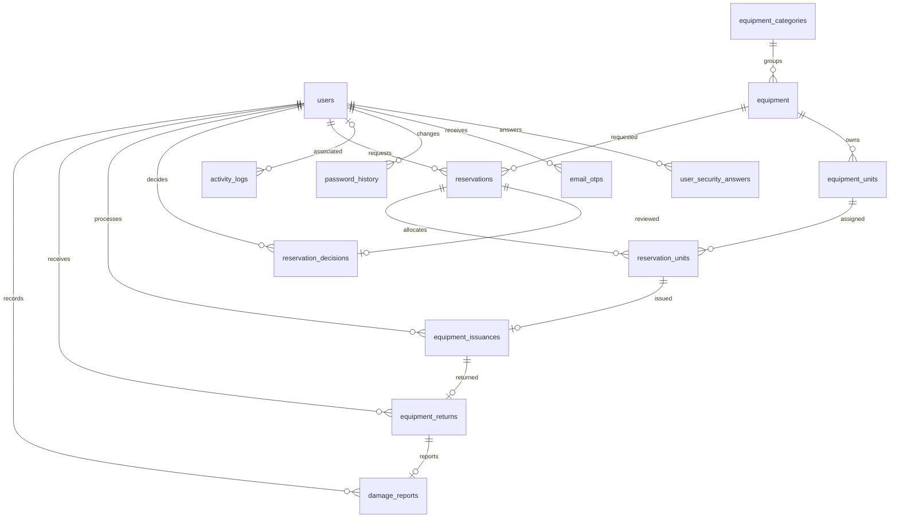

# LabGear — PostgreSQL Database Dictionary

**Project:** LabGear — School Laboratory Equipment Reservation System  
**Course:** IT 107 — Information Assurance and Security 1  
**Database:** `labgear_db` · **Schema:** `public` · **Engine:** PostgreSQL  
**Document version:** 1.0 · **Date:** November 6, 2026  
**Destination:** `LabGear/docs/DATABASE_DICTIONARY.md`  
**Database structure:** **16 tables + 1 read-only view**  
**Status:** Technical documentation; live production workflows are not yet established.

> **Source and scope.** The 15 tables other than `users` are documented directly from the available LabGear ORM files: `backend/app/models/auth.py`, `security.py`, `inventory.py`, and `reservations.py`. These mapped columns were previously reported to match PostgreSQL by read-only checks in Backend Steps 30, 32, and 34. The `users` ORM source is not available with the current document materials; therefore its 27-column definition is **not reconstructed or guessed**. The `users` section lists only fields referenced in the Step 51 registration service and must be reconciled against `backend/app/models/user.py` or PostgreSQL. ORM-declared defaults, indexes and CHECK constraints are **design claims to verify in PostgreSQL** because those features were outside the previous checker scope.

## 1. Database design overview

| Domain | Tables | Purpose |
|---|---|---|
| Identity and authentication | `users`, `user_security_answers`, `email_otps`, `password_history` | Accounts, hashed answers, OTP lifecycle, password history |
| Security and monitoring | `activity_logs`, `ip_blocks`, `security_flags` | Auditing, rate controls, suspicious patterns |
| Inventory | `equipment_categories`, `equipment`, `equipment_units` | Catalog and physical assets |
| Reservations and transactions | `reservations`, `reservation_decisions`, `reservation_units`, `equipment_issuances`, `equipment_returns`, `damage_reports` | Booking, approval, allocation, issue, return, damage |
| Reporting | `equipment_stock_summary` (**view**) | Aggregated stock status by equipment |

**Notation:** `PK` = primary key; `FK` = foreign key; `—` = neither; `No/Yes` in the Nullable column describes the mapped column's nullability. `TIMESTAMPTZ` is PostgreSQL timestamp with time zone; `JSONB` stores structured JSON. SQL defaults are summarized separately; this file does not claim they were live-verified.

## 2. Relationships



`ip_blocks` and `security_flags` have no declared foreign keys in their ORM mappings. The stock-summary view derives reporting values from inventory data; it is not an independently editable entity. The diagram is a logical overview, not a guarantee that optionalities are exactly enforced beyond the mapped keys/uniqueness.

## 3. Identity and authentication tables

### 3.1 `users` — account profiles (**partial column listing; reconcile before treating as complete**)

**Role:** Holds account identity, registration, authentication/verification state and profile details. Earlier schema verification reported **27 columns** with model/DB column names, types, nullability, primary key and foreign keys matching. The current materials do not contain the actual `app/models/user.py` mapping. **The following are fields used by the Step 51 registration service, not a full typed schema extract:**

| Referenced field | Intended use | Evidence boundary |
|---|---|---|
| `id_number` | User identifier, referenced by dependent tables | PK target confirmed through other ORM foreign-key definitions |
| `first_name`, `middle_name`, `family_name`, `name_extension` | Personal-name information | Registration service references |
| `birthdate` | Birth date/age eligibility | Registration service references |
| `purok_street`, `barangay`, `municipality_city`, `province`, `country`, `zip_code` | Registration address | Registration service references |
| `email`, `username` | Account identifiers | Registration service references |
| `password_hash` | Argon2id password digest | Registration service references |
| `role`, `department`, `class_section_or_unit` | Account authorization context and institution details | Registration service references |
| `contact_number_encrypted`, `contact_number_iv` | AES-256-GCM protected contact and nonce | Registration service references |
| `is_email_verified`, `account_status` | Email-verification and account activation state | Registration service references |
| `failed_login_attempts`, `privacy_consent_at` | Login abuse counter and consent timestamp | Registration service references |

**Do not infer unlisted names or the exact SQL types/nullability.** The role names intended by this project are `student`, `instructor`, `technician`, `admin`. Public self-registration is intended only for `student`/`instructor`. The service prepares `is_email_verified = false` and `account_status = 'inactive'`; successful verification/activation is still pending integration.

**Complete this section later:** From inside your LabGear `backend` directory, inspect `app/models/user.py`, and use the read-only SQL in §8 to capture the 27 actual columns and their constraints. The live SQL definition, not service assumptions, is the authoritative source.

### 3.2 `user_security_answers` — Security questions

Argon2id-hashed answers to assigned Q7, Q2, Q4 recovery questions.

**Column count:** 5 · **Source:** `backend/app/models/auth.py`

| Column | SQL type | Nullable | Key | Description |
|---|---|---|---|---|
| `id` | `BIGINT` | No | PK | Surrogate primary key |
| `user_id` | `VARCHAR(9)` | No | FK | User/account identifier → `users.id_number (CASCADE)` |
| `question_code` | `VARCHAR(2)` | No | — | Assigned recovery question code |
| `answer_hash` | `TEXT` | No | — | Hashed recovery answer, not plaintext |
| `created_at` | `TIMESTAMPTZ` | No | — | Record creation timestamp |

**Rules / notes:** Unique pair: (`user_id`, `question_code`); `user_id` cascade-deletes with the account.

### 3.3 `email_otps` — Email one-time codes

Purpose-bound OTP HMAC digests, attempt counters, expiration and consumption/revocation markers.

**Column count:** 10 · **Source:** `backend/app/models/auth.py`

| Column | SQL type | Nullable | Key | Description |
|---|---|---|---|---|
| `id` | `BIGINT` | No | PK | Surrogate primary key |
| `user_id` | `VARCHAR(9)` | No | FK | User/account identifier → `users.id_number (CASCADE)` |
| `otp_hash` | `TEXT` | No | — | Keyed digest of OTP; never plaintext |
| `purpose` | `VARCHAR(20)` | No | — | OTP flow: register / login / reset |
| `failed_attempts` | `INTEGER` | No | — | OTP failure counter |
| `is_resend` | `BOOLEAN` | No | — | Whether OTP issuance was a resend |
| `created_at` | `TIMESTAMPTZ` | No | — | Record creation timestamp |
| `expires_at` | `TIMESTAMPTZ` | No | — | OTP expiration timestamp |
| `used_at` | `TIMESTAMPTZ` | Yes | — | When OTP was successfully consumed |
| `revoked_at` | `TIMESTAMPTZ` | Yes | — | When OTP was invalidated |

**Rules / notes:** Application must enforce OTP `used_at IS NULL`, `revoked_at IS NULL`, valid `expires_at`, maximum three failed attempts, and purpose binding under a transaction. **The database `purpose` CHECK was identified as `register`, `login`, `reset`**, so service and request schema strings must match. These lifecycle rules are not implied by the model alone.

### 3.4 `password_history` — Password reuse prevention

Previous password hashes used to disallow reuse of the most recent three passwords.

**Column count:** 4 · **Source:** `backend/app/models/auth.py`

| Column | SQL type | Nullable | Key | Description |
|---|---|---|---|---|
| `id` | `BIGINT` | No | PK | Surrogate primary key |
| `user_id` | `VARCHAR(9)` | No | FK | User/account identifier → `users.id_number (CASCADE)` |
| `password_hash` | `TEXT` | No | — | Hashed password; no plaintext password |
| `created_at` | `TIMESTAMPTZ` | No | — | Record creation timestamp |

**Rules / notes:** The model records hashes and timestamps, but limiting password reuse to the last three requires application enforcement.

## 4. Security and monitoring tables

### 4.1 `activity_logs` — Security audit trail

Append-only activity events, optional user/IP metadata and JSONB details.

**Column count:** 8 · **Source:** `backend/app/models/security.py`

| Column | SQL type | Nullable | Key | Description |
|---|---|---|---|---|
| `id` | `BIGINT` | No | PK | Surrogate primary key |
| `event_type` | `VARCHAR(50)` | No | — | Security/audit event name |
| `username_typed` | `TEXT` | Yes | — | Username entered in attempted authentication |
| `user_id` | `VARCHAR(9)` | Yes | FK | User/account identifier → `users.id_number (SET NULL)` |
| `ip_address` | `INET` | Yes | — | Client IP address |
| `user_agent` | `TEXT` | Yes | — | Browser/client identification string |
| `details` | `JSONB` | No | — | JSONB event or flag metadata |
| `created_at` | `TIMESTAMPTZ` | No | — | Record creation timestamp |

**Rules / notes:** `user_id` references `users.id_number` with `ON DELETE SET NULL`. The model does not itself prove append-only database permissions. IP and user agent are optional.

### 4.2 `ip_blocks` — Temporary network restrictions

IP addresses and blocking windows established by future anti-abuse services.

**Column count:** 6 · **Source:** `backend/app/models/security.py`

| Column | SQL type | Nullable | Key | Description |
|---|---|---|---|---|
| `id` | `BIGINT` | No | PK | Surrogate primary key |
| `ip_address` | `INET` | No | — | Client IP address |
| `reason` | `VARCHAR(255)` | No | — | Reason for IP restriction |
| `failure_count` | `INTEGER` | No | — | Recorded failures related to block |
| `blocked_at` | `TIMESTAMPTZ` | No | — | Start of IP block |
| `blocked_until` | `TIMESTAMPTZ` | No | — | End of IP block |

**Rules / notes:** ORM-declared checks: `failure_count >= 0` and `blocked_until > blocked_at`. The 14-failures/10-minute rule is an application-level policy.

### 4.3 `security_flags` — Suspicious activity indicators

Daily, deduplicated patterns detected by the monitoring job.

**Column count:** 7 · **Source:** `backend/app/models/security.py`

| Column | SQL type | Nullable | Key | Description |
|---|---|---|---|---|
| `id` | `BIGINT` | No | PK | Surrogate primary key |
| `pattern_type` | `VARCHAR(40)` | No | — | Security pattern identifier |
| `target_value` | `VARCHAR(255)` | No | — | Affected IP / user / pattern target |
| `severity` | `VARCHAR(10)` | No | — | LOW / MEDIUM / HIGH |
| `details` | `JSONB` | No | — | JSONB event or flag metadata |
| `flag_date` | `DATE` | No | — | Date of security flag in Philippine time |
| `created_at` | `TIMESTAMPTZ` | No | — | Record creation timestamp |

**Rules / notes:** ORM-declared checks: pattern is `IP_OVER_THRESHOLD`, `ACCOUNT_TARGETED`, `OTP_GUESSING`, or `OFF_HOURS_LOGIN`; severity is `LOW`, `MEDIUM`, or `HIGH`. Unique (`pattern_type`, `target_value`, `flag_date`).

## 5. Inventory tables

### 5.1 `equipment_categories` — Inventory categories

Category names for grouping types of equipment.

**Column count:** 5 · **Source:** `backend/app/models/inventory.py`

| Column | SQL type | Nullable | Key | Description |
|---|---|---|---|---|
| `id` | `BIGINT` | No | PK | Surrogate primary key |
| `category_name` | `VARCHAR(80)` | No | — | Inventory category name |
| `description` | `TEXT` | Yes | — | Free-text description |
| `created_at` | `TIMESTAMPTZ` | No | — | Record creation timestamp |
| `updated_at` | `TIMESTAMPTZ` | No | — | Record update timestamp |

**Rules / notes:** ORM-declared unique functional index on `lower(category_name)` (`idx_category_name`).

### 5.2 `equipment` — Equipment catalog

Catalog definition for an equipment type, separate from each physical asset.

**Column count:** 10 · **Source:** `backend/app/models/inventory.py`

| Column | SQL type | Nullable | Key | Description |
|---|---|---|---|---|
| `id` | `BIGINT` | No | PK | Surrogate primary key |
| `category_id` | `BIGINT` | No | FK | Equipment category reference → `equipment_categories.id (RESTRICT)` |
| `equipment_code` | `VARCHAR(30)` | No | — | Unique catalog code |
| `equipment_name` | `VARCHAR(120)` | No | — | Equipment display name |
| `description` | `TEXT` | Yes | — | Free-text description |
| `manufacturer` | `VARCHAR(100)` | Yes | — | Optional manufacturer name |
| `model_number` | `VARCHAR(100)` | Yes | — | Optional model designation |
| `is_active` | `BOOLEAN` | No | — | Catalog availability flag |
| `created_at` | `TIMESTAMPTZ` | No | — | Record creation timestamp |
| `updated_at` | `TIMESTAMPTZ` | No | — | Record update timestamp |

**Rules / notes:** `equipment_code` is declared unique; `category_id` uses `ON DELETE RESTRICT`. Physical stock is tracked separately in `equipment_units`.

### 5.3 `equipment_units` — Physical inventory units

Individually tagged inventory assets and their current condition/availability state.

**Column count:** 10 · **Source:** `backend/app/models/inventory.py`

| Column | SQL type | Nullable | Key | Description |
|---|---|---|---|---|
| `id` | `BIGINT` | No | PK | Surrogate primary key |
| `equipment_id` | `BIGINT` | No | FK | Equipment catalog reference → `equipment.id (RESTRICT)` |
| `asset_tag` | `VARCHAR(50)` | No | — | Unique physical-unit tag |
| `serial_number` | `VARCHAR(100)` | Yes | — | Manufacturer serial identifier (optional) |
| `storage_location` | `VARCHAR(100)` | Yes | — | Physical storage location |
| `unit_status` | `VARCHAR(20)` | No | — | Physical unit lifecycle state |
| `acquired_at` | `DATE` | Yes | — | Acquisition date |
| `notes` | `TEXT` | Yes | — | Free-text notes |
| `created_at` | `TIMESTAMPTZ` | No | — | Record creation timestamp |
| `updated_at` | `TIMESTAMPTZ` | No | — | Record update timestamp |

**Rules / notes:** `asset_tag` and optional `serial_number` are declared unique. ORM-declared status values: `available`, `reserved`, `issued`, `returned`, `damaged`, `maintenance`, `retired`.

## 6. Reservation and transaction tables

### 6.1 `reservations` — Reservation requests

Student/Instructor equipment booking requests and requested time windows.

**Column count:** 11 · **Source:** `backend/app/models/reservations.py`

| Column | SQL type | Nullable | Key | Description |
|---|---|---|---|---|
| `id` | `BIGINT` | No | PK | Surrogate primary key |
| `reservation_code` | `VARCHAR(30)` | No | — | Unique reservation code |
| `requester_id` | `VARCHAR(9)` | No | FK | Student/Instructor requesting equipment → `users.id_number (RESTRICT)` |
| `equipment_id` | `BIGINT` | No | FK | Equipment catalog reference → `equipment.id (RESTRICT)` |
| `quantity` | `INTEGER` | No | — | Number of units requested (1–50) |
| `purpose` | `TEXT` | No | — | OTP flow: register / login / reset |
| `reservation_start` | `TIMESTAMPTZ` | No | — | Requested start timestamp |
| `reservation_end` | `TIMESTAMPTZ` | No | — | Requested end timestamp |
| `status` | `VARCHAR(25)` | No | — | Reservation lifecycle status |
| `created_at` | `TIMESTAMPTZ` | No | — | Record creation timestamp |
| `updated_at` | `TIMESTAMPTZ` | No | — | Record update timestamp |

**Rules / notes:** ORM-declared checks: quantity **1 to 50**; `reservation_end > reservation_start`; status is `pending`, `approved`, `rejected`, `cancelled`, `partially_issued`, `issued`, or `completed`.

### 6.2 `reservation_decisions` — Technician decisions

Single approve/reject decision recorded for a reservation.

**Column count:** 6 · **Source:** `backend/app/models/reservations.py`

| Column | SQL type | Nullable | Key | Description |
|---|---|---|---|---|
| `id` | `BIGINT` | No | PK | Surrogate primary key |
| `reservation_id` | `BIGINT` | No | FK | Reservation reference → `reservations.id (RESTRICT)` |
| `decided_by` | `VARCHAR(9)` | No | FK | Account ID of decision-maker → `users.id_number (RESTRICT)` |
| `decision` | `VARCHAR(15)` | No | — | Approved/rejected outcome |
| `remarks` | `TEXT` | Yes | — | Optional decision remarks |
| `decided_at` | `TIMESTAMPTZ` | No | — | Decision timestamp |

**Rules / notes:** `reservation_id` is unique (at most one decision per reservation). Decision allowed values: `approved`, `rejected`.

### 6.3 `reservation_units` — Reserved physical units

Associates an approved reservation with specific unit records.

**Column count:** 5 · **Source:** `backend/app/models/reservations.py`

| Column | SQL type | Nullable | Key | Description |
|---|---|---|---|---|
| `id` | `BIGINT` | No | PK | Surrogate primary key |
| `reservation_id` | `BIGINT` | No | FK | Reservation reference → `reservations.id (RESTRICT)` |
| `equipment_unit_id` | `BIGINT` | No | FK | Physical unit reference → `equipment_units.id (RESTRICT)` |
| `allocation_status` | `VARCHAR(20)` | No | — | Reservation-to-unit allocation state |
| `allocated_at` | `TIMESTAMPTZ` | No | — | Time physical unit was allocated |

**Rules / notes:** Unique (`reservation_id`, `equipment_unit_id`). Allocation states: `reserved`, `issued`, `returned`, `cancelled`. A unit may appear in multiple historical allocations; overlapping-live-reservation exclusion requires additional logic.

### 6.4 `equipment_issuances` — Equipment check-outs

Actual issuance of a reserved unit, due date and handoff condition.

**Column count:** 7 · **Source:** `backend/app/models/reservations.py`

| Column | SQL type | Nullable | Key | Description |
|---|---|---|---|---|
| `id` | `BIGINT` | No | PK | Surrogate primary key |
| `reservation_unit_id` | `BIGINT` | No | FK | Reservation-unit allocation reference → `reservation_units.id (RESTRICT)` |
| `issued_by` | `VARCHAR(9)` | No | FK | Account ID of issuing staff member → `users.id_number (RESTRICT)` |
| `issued_at` | `TIMESTAMPTZ` | No | — | Issue timestamp |
| `due_at` | `TIMESTAMPTZ` | No | — | Required return timestamp |
| `condition_on_issue` | `VARCHAR(20)` | No | — | Condition of the unit at checkout |
| `issuance_notes` | `TEXT` | Yes | — | Optional checkout notes |

**Rules / notes:** `reservation_unit_id` is unique (one issuance record per allocation). `condition_on_issue` allowed: `good`, `fair`, `worn`.

### 6.5 `equipment_returns` — Equipment check-ins

Actual return of an issuance, received-by and return condition.

**Column count:** 6 · **Source:** `backend/app/models/reservations.py`

| Column | SQL type | Nullable | Key | Description |
|---|---|---|---|---|
| `id` | `BIGINT` | No | PK | Surrogate primary key |
| `issuance_id` | `BIGINT` | No | FK | Issued unit reference → `equipment_issuances.id (RESTRICT)` |
| `received_by` | `VARCHAR(9)` | No | FK | Account ID of receiving staff member → `users.id_number (RESTRICT)` |
| `returned_at` | `TIMESTAMPTZ` | No | — | Return timestamp |
| `return_condition` | `VARCHAR(25)` | No | — | Condition of the unit at check-in |
| `return_notes` | `TEXT` | Yes | — | Optional return notes |

**Rules / notes:** `issuance_id` is unique (one return record per issuance). `return_condition` allowed: `good`, `damaged`, `needs_maintenance`.

### 6.6 `damage_reports` — Damage follow-up

Damage assessment and resolution details for returned equipment.

**Column count:** 9 · **Source:** `backend/app/models/reservations.py`

| Column | SQL type | Nullable | Key | Description |
|---|---|---|---|---|
| `id` | `BIGINT` | No | PK | Surrogate primary key |
| `return_id` | `BIGINT` | No | FK | Equipment return reference → `equipment_returns.id (RESTRICT)` |
| `reported_by` | `VARCHAR(9)` | No | FK | Account ID of damage reporter → `users.id_number (RESTRICT)` |
| `damage_description` | `TEXT` | No | — | Description of damage found |
| `severity` | `VARCHAR(20)` | No | — | LOW / MEDIUM / HIGH |
| `resolution_status` | `VARCHAR(20)` | No | — | Damage investigation/resolution state |
| `reported_at` | `TIMESTAMPTZ` | No | — | Damage report timestamp |
| `resolved_at` | `TIMESTAMPTZ` | Yes | — | Optional resolution timestamp |
| `resolution_notes` | `TEXT` | Yes | — | Optional outcome notes |

**Rules / notes:** `return_id` is unique (at most one damage report per return). Severity allowed: `minor`, `moderate`, `severe`. Resolution allowed: `open`, `in_review`, `resolved`.

## 7. Reporting view

### 7.1 `equipment_stock_summary` — PostgreSQL view

**Purpose:** One row per equipment record with stock counts. **Read-only by design**; use to report available inventory without mutating unit records. It is represented by `equipment_stock_summary` in `backend/app/models/inventory.py` using a separate `MetaData` object, not registered in `Base.metadata` as a writable ORM table. The earlier Step 32 check compared view **column names and types**, not view definition semantics or view keys/nullability.

| Column | Mapped type | Meaning |
|---|---|---|
| `equipment_id` | `BIGINT` | Catalog item identifier (logical identifier, not an enforced VIEW primary key) |
| `equipment_code` | `VARCHAR(30)` | Catalog code |
| `equipment_name` | `VARCHAR(120)` | Catalog name |
| `category_name` | `VARCHAR(80)` | Category name |
| `total_units` | `BIGINT` | Total physical units |
| `available_units` | `BIGINT` | Units in available state |
| `reserved_units` | `BIGINT` | Units in reserved state |
| `issued_units` | `BIGINT` | Units in issued state |
| `damaged_units` | `BIGINT` | Units in damaged state |
| `maintenance_units` | `BIGINT` | Units in maintenance state |

**Caution:** The view also does not expose a separate count for `returned` or `retired`; verify how the SQL view handles each state before interpreting stock balances.

## 8. Read-only PostgreSQL verification and evidence

Run from **pgAdmin 4 Query Tool** connected to **`labgear_db`** (never paste passwords or encryption keys into documentation).

**A. Check actual table/view names and kinds**

```sql
SELECT table_name, table_type
FROM information_schema.tables
WHERE table_schema = 'public'
ORDER BY table_name;
```

**B. Capture complete columns of `users` (and their SQL types / nullability)**

```sql
SELECT ordinal_position, column_name, data_type,
       character_maximum_length, is_nullable, column_default
FROM information_schema.columns
WHERE table_schema = 'public'
  AND table_name = 'users'
ORDER BY ordinal_position;
```

**C. Capture actual foreign keys and their delete rules**

```sql
SELECT tc.table_name, kcu.column_name,
       ccu.table_name AS referenced_table,
       ccu.column_name AS referenced_column,
       rc.delete_rule
FROM information_schema.table_constraints AS tc
JOIN information_schema.key_column_usage AS kcu
  ON tc.constraint_name = kcu.constraint_name
 AND tc.constraint_schema = kcu.constraint_schema
JOIN information_schema.constraint_column_usage AS ccu
  ON tc.constraint_name = ccu.constraint_name
 AND tc.constraint_schema = ccu.constraint_schema
JOIN information_schema.referential_constraints AS rc
  ON tc.constraint_name = rc.constraint_name
 AND tc.constraint_schema = rc.constraint_schema
WHERE tc.constraint_type = 'FOREIGN KEY'
  AND tc.table_schema = 'public'
ORDER BY tc.table_name, kcu.column_name;
```

**D. Capture CHECK and UNIQUE constraints, including the OTP purpose check**

```sql
SELECT conrelid::regclass AS object_name,
       conname AS constraint_name,
       pg_get_constraintdef(oid) AS definition
FROM pg_constraint
WHERE connamespace = 'public'::regnamespace
  AND contype IN ('c', 'u')
ORDER BY object_name, constraint_name;
```

**E. Capture the stock view definition**

```sql
SELECT pg_get_viewdef('public.equipment_stock_summary'::regclass, true);
```

**F. Re-run existing backend schema checkers**

From `LabGear/backend` with your virtual environment active:

```powershell
python verify_auth_security_schema.py
python verify_inventory_schema.py
python verify_reservation_schema.py
python -m app.models.registry
```

All are designed as read-only checks. Earlier runs were user-reported successful. Screenshots of each verification result belong in `docs/TEST_LOG.md` when that file is created.

## 9. Data integrity, privacy, and access notes

- Passwords and security answers should store **Argon2id hashes**, never plaintext; OTPs store HMAC digests keyed using a private backend secret.
- Contact numbers should be saved as **AES-256-GCM ciphertext and nonce**, not plaintext, with a separate stable key. The ORM and DB do not themselves authorize who may decrypt contacts; the API must enforce record-level access.
- The `users` table must not be created by publicly accepting `technician` or `admin` roles. Role authorization must be checked at every protected route.
- The registration service currently prepares **inactive, unverified accounts**. OTP verification/activation, OTP resend policy, and transaction-safe account changes remain unfinished.
- Audit logs must not contain plaintext passwords, OTPs, security answers, signing keys, contact numbers, or full sensitive payloads.
- IP blocks, activity auditing, and security flagging require live backend services and appropriate database permissions; merely having the tables is insufficient.
- All user-facing and privileged operations should run through authenticated, authorized backend services, not direct database writes from React.
- Recorded database relationships prevent invalid FK references; they **do not** alone prevent conflicting reservations, double issuance, or unsafe state transitions. Those are service-layer concerns.

## 10. Documentation and completion status

| Item | Status |
|---|---|
| 16 PostgreSQL tables and 1 view named | Previously user-reported verified |
| 15 table ORM column descriptions | Documented from available LabGear mapping files |
| Complete 27-column `users` specification | **Pending:** actual model/DB column extract needed |
| PostgreSQL defaults / indexes / UNIQUE/CHECK constraints | **Pending:** independent metadata verification |
| Live API transactions and row-level authorization | **Pending** |
| Schema validation scripts (Steps 30, 32, 34, 35) | User-reported passed; limited to their stated coverage |

**Maintainer rule:** Update this dictionary whenever a migration intentionally changes PostgreSQL schema. Keep the final schema and live verification logs in agreement; never silently edit database definitions to make a document look consistent.
